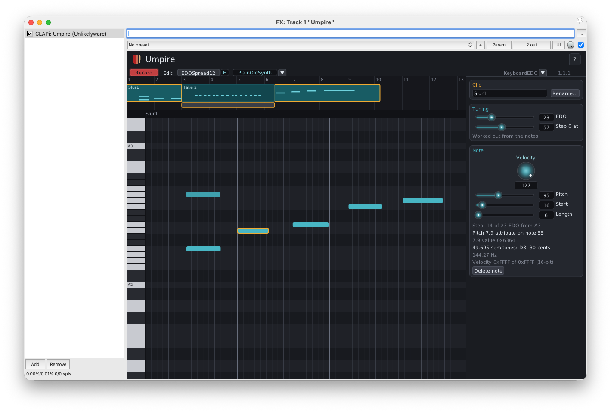

# Umpire

An instrument plugin from Unlikelyware that records, edits and plays MIDI 2.0 inside your DAW,
keeping what the DAW would throw away: exact pitch on every note, in any equal division of the
octave (EDO), and per-note expression. Put it on a track in REAPER, Bitwig, Ardour or Logic, play
a MIDI 2.0 keyboard such as [KeyboardEDO](https://github.com/erickampman/KeyboardEDO), and the
synth it hosts hears every note as it was played.



| | |
|---|---|
| Formats | CLAP, VST® 3, and AUv2 on macOS, all built from source |
| Platforms | Linux x86-64, macOS 26 or later on Apple Silicon. No Windows |
| Version | 0.9.1, source only: not in the Unlikelyware previews, and no ready-built download |
| License | MIT |

This repo also holds `umpire-daw`, a standalone MIDI 2.0 DAW that Umpire grew out of. Neither
the plugin nor the app is released.

## What makes it different

- **The notes never pass through the host.** Today's DAWs give plugins MIDI 1.0 or their own
  note events, rounding pitch to semitones. Umpire opens the MIDI 2.0 input itself (a device, or
  KeyboardEDO's port), hosts the synth itself, and gives the host only audio. How the host
  treats MIDI no longer matters.
- **MIDI 2.0 throughout.** Takes are kept as Universal MIDI Packets, Pitch 7.25 and per-note
  controllers included, and played to the synth as MIDI 2.0 where it takes it.
- **The host does the rest.** Recording follows the host's transport and tempo; the takes and
  the synth's patch are saved in the host's project; mixing, effects and rendering stay the
  host's.
- **Microtonal editing.** A take's notes sit on a grid of the EDO's steps, not a piano roll of
  semitones.

## Using it

- **Record:** Umpire records while the host records and its own Record is on (off when it's
  added; turn it on in its window or the host's view of its parameters). Every take is kept; the
  newest is heard where takes overlap, and a jump while recording starts a new take, so loop
  recording works. Takes live inside the plugin, not on the host's timeline.
- **The host may record a clip of its own** on Umpire's track as well, since it records an
  armed track as usual. It does no harm (Umpire doesn't listen to it, so it plays nothing and
  editing it changes nothing), but two recordings of one performance can confuse. Ardour won't
  record without an armed track, so there you'll get one: delete or ignore it. In Bitwig, turn
  off the track's record arm; in REAPER, leave it armed with monitoring on and set its record
  mode to "Record: disable (input monitoring only)". It's a workaround: until DAWs pass MIDI
  2.0 through to plugins, taking the notes straight from the input is what keeps them whole.
- **The window** shows the lane of takes in the host's bars and the selected take's grid, with
  its own undo. The ▾ beside the input and the synth chooses them, saved with the project, so
  each track can have its own. The synth's editor opens from the button with its name.
- **MIDI effects** (Retune, NoteGran, EDOSpread12 or others' CLAP note effects) go inside
  Umpire, in front of the synth: the host's own note effects never reach it.
- **Takes as files:** Edit > Export take... saves a MIDI Clip File (`.midi2`); Import clip...
  puts one at the playhead.

## Hosts

| Host | Format | Notes |
|---|---|---|
| REAPER | CLAP | For the grid's keys, turn on "Send all keyboard input to plugin" |
| Bitwig | CLAP | |
| Ardour | VST3 | Open Umpire's window once per session if the synth needs timers |
| Logic, MainStage | AUv2 | |

On Linux with PipeWire, the block size comes from PipeWire: start the host with
`pw-jack -p 256` (or set PipeWire's quantum) for a short delay between playing and hearing.

## Building from source

```bash
git clone https://github.com/erickampman/UmpireDAW.git
cd UmpireDAW
tools/fetch_deps.sh
cmake -B build -G Ninja -DCMAKE_BUILD_TYPE=Release
cmake --build build
```

[BUILDING.md](BUILDING.md) has the prerequisites for Linux and macOS, the VST3 and AUv2 options
and where each format installs. [docs/plugin-version.md](docs/plugin-version.md) explains how the
plugin works; [CONTRIBUTING.md](CONTRIBUTING.md) is where to start on the code.

## Help and bugs

Questions and bug reports go to [GitHub Issues](https://github.com/erickampman/UmpireDAW/issues).

## License

MIT. See [LICENSE](LICENSE). Third-party components and their licenses are in
[THIRD_PARTY_NOTICES.md](THIRD_PARTY_NOTICES.md).

## Trademarks

VST is a registered trademark of Steinberg Media Technologies GmbH. Audio Units, Logic,
MainStage, Mac and macOS are trademarks of Apple Inc., registered in the U.S. and other
countries. Linux is the registered trademark of Linus Torvalds in the U.S. and other countries.
Other product names are trademarks of their owners, named here only to say what works with what.
